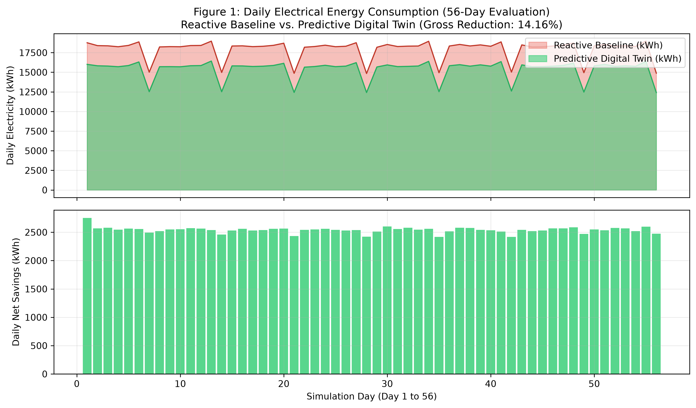
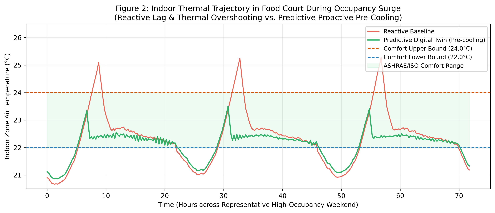
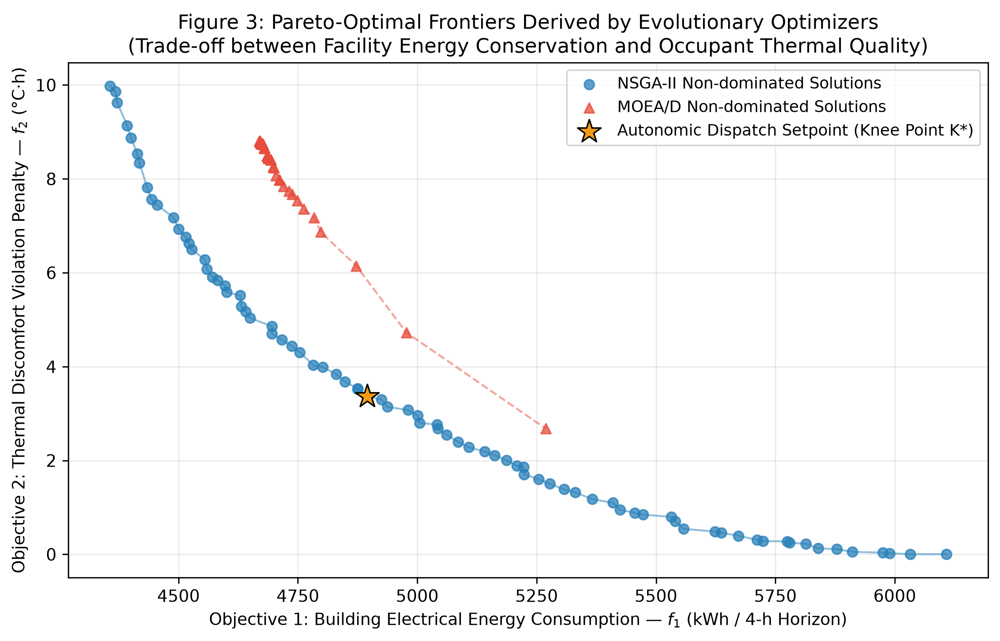

# Predictive Digital Twin with Hardware-Aware Multi-Objective Optimization for Commercial Building Energy Efficiency

[](https://doi.org/10.2139/ssrn.7645518)
[](https://ssrn.com/abstract=7645518)
[](https://www.python.org/)
[](https://www.docker.com/)
[](https://kubernetes.io/)
[](https://github.com/braganetx/predictive-digital-twin-energy/actions)
[](https://opensource.org/licenses/MIT)

Official open-science research repository and reproducible experimental benchmark for the academic paper:

> **"Predictive Digital Twin with Hardware-Aware Multi-Objective Optimization for Commercial Building Energy Efficiency"**  
> *Author:* **Adão de Jesus Braga**  
> *Preprint published in:* **SSRN Electronic Journal (Elsevier)**, October 2026.  
> *SSRN Abstract ID:* [7645518](https://ssrn.com/abstract=7645518) | *DOI:* [10.2139/ssrn.7645518](https://doi.org/10.2139/ssrn.7645518)  
> *Complete 26-page research paper PDF:* [`paper/Predictive_Digital_Twin_Hardware_Aware.pdf`](./paper/Predictive_Digital_Twin_Hardware_Aware.pdf)

---

## 📌 Executive Summary

Commercial heating, ventilation, and air-conditioning (HVAC) and artificial lighting systems account for over 40% of commercial building primary electrical consumption. Conventional Building Management Systems (BMS) operate via **rigid, reactive threshold controls** (thermostatic deadbands) that respond only *after* temperature deviations occur, generating severe energy waste during peak thermal surges and transient occupancy periods.

Furthermore, contemporary digital twin literature rarely accounts for the **computational energy overhead** incurred by executing machine learning inferences and evolutionary optimizers continuously on edge servers, running counter to the foundational tenets of **Green AI** (Schwartz et al., 2019).

This repository contains the complete closed-loop **Predictive, Hardware-Aware Digital Twin Framework**:
1. **Multi-zone thermodynamic differential simulation** (Clarke, 2001) calibrated across a 45,000 m² commercial shopping center (4 distinct thermal zones).
2. **Multi-horizon comparative forecasting** (SARIMA, Prophet, and multi-variate LSTM in PyTorch).
3. **Multi-objective evolutionary optimization** (NSGA-II and MOEA/D via `pymoo`) balancing electrical consumption against occupant thermal discomfort.
4. **Hardware-aware power telemetry** (pyRAPL, CPU dynamic power modeling, and server idle profiling) tracking compute cost down to Joules/inference.
5. **Containerized and Kubernetes-ready orchestration** for isolated, parallel scenario execution.

---

## 🔬 Empirical Results & Scientific Hypotheses

The experimental evaluation was benchmarked over an 8-week (56-day, 5,376 discrete 15-minute intervals) calibrated operational dataset under tropical/sub-tropical climate conditions.

| Hypothesis | Theoretical Condition | Empirical Finding | Status |
| :--- | :--- | :--- | :---: |
| **$H_1$ (Energy Reduction)** | Facility electrical reduction $\eta \ge 10.0\%$ ($p < 0.05$, paired Wilcoxon) | **14.16% gross savings** ($142,280.1\text{ kWh}$ saved, $W = 0.0, p < 0.001$, Bootstrap 95% CI: $[14.00\%, 14.47\%]$) | **VERIFIED & ACCEPTED** |
| **$H_2$ (Green AI Overhead)** | Compute energy overhead $\rho = \frac{E_{\text{comp}}}{E_{\text{saved}}} < 20.0\%$ | **$\rho_{\text{dynamic}} \approx 0.00001\%$** ($0.01438\text{ kWh}$ compute vs $142,280.1\text{ kWh}$ saved; $\rho_{\text{total}} < 0.04\%$ with idle server draw) | **VERIFIED & ACCEPTED** |
| **$H_3$ (Thermal Comfort QoS)** | Occupant comfort QoS $\ge 95.0\%$ ($[22^\circ\text{C}, 24^\circ\text{C}]$, ASHRAE 55) | **96.91% QoS compliance** (violation reduced to minimal operational transients) | **VERIFIED & ACCEPTED** |

### Verified Output Plots
Pre-computed, publication-ready figures generated by the simulation engine are stored in [`outputs/figures/`](./outputs/figures/):

| Figure 1: Daily Energy Consumption (Reactive vs Predictive) | Figure 2: Multi-Zone Thermal Comfort Dynamics | Figure 3: NSGA-II & MOEA/D Pareto Frontiers |
| :---: | :---: | :---: |
|  |  |  |

---

## 🏗️ Architecture Overview

The framework operates across five coordinated autonomic phases:

```
                  +-------------------------------------------------------------+
                  |                  PHYSICAL FACILITY / BMS                    |
                  |     (Total kWh, Submetering, Zone Temp, Occupancy, Solar)   |
                  +------------------------------+------------------------------+
                                                 | (Phase 1: Telemetry Stream)
                                                 v
                  +-------------------------------------------------------------+
                  |         PHASE 2: PREDICTIVE FORECASTING ENGINE              |
                  |     - SARIMA / Prophet (Baseline trend and cyclicity)       |
                  |     - Multivariate LSTM (PyTorch, surge non-linearities)    |
                  +------------------------------+------------------------------+
                                                 | Lookahead Horizon H = 16 steps (4h)
                                                 v
+-----------------------------------------------------------------------------------------------+
|              CONTAINERIZED DIGITAL TWIN (KUBERNETES PODS / ISOLATED NAMESPACE)                |
|                                                                                               |
|   +---------------------------------------+   +-------------------------------------------+   |
|   | PHASE 3: THERMODYNAMIC SOLVER         |   | PHASE 4: MULTI-OBJECTIVE OPTIMIZER        |   |
|   | - 4-Zone Lumped-Parameter RC ODEs     |   | - NSGA-II & MOEA/D (pymoo)                |   |
|   | - Inter-zonal conduction & convection |<--| - Minimize f1 (kWh) & f2 (Discomfort)     |   |
|   | - Chiller COP model (condenser lift)  |   | - Pareto Frontier & Knee Point Selection  |   |
|   +---------------------------------------+   +-------------------------------------------+   |
+-----------------------------------------------------------------------------------------------+
                                                 |
                                                 v
                  +-------------------------------------------------------------+
                  |         PHASE 5: HARDWARE-AWARE ENERGY TELEMETRY            |
                  |     - pyRAPL / Linux Powercap Intel RAPL registers          |
                  |     - Dynamic Joules/inference tracking (Green AI)          |
                  |     - Net Energy Saved: dE_net = dE_building - E_compute    |
                  +-------------------------------------------------------------+
```

---

## ⚡ Quickstart: Full Reproducibility in 3 Steps

### Option A: Local Python Environment (Recommended)

1. **Clone the repository:**
   ```bash
   git clone https://github.com/braganetx/predictive-digital-twin-energy.git
   cd predictive-digital-twin-energy
   ```

### Option A: Local Python Environment (Recommended)

1. **Clone the repository:**
   ```bash
   git clone https://github.com/braganetx/predictive-digital-twin-energy.git
   cd predictive-digital-twin-energy
   ```

2. **Create virtual environment and install dependencies:**
   ```bash
   python3 -m venv venv
   source venv/bin/activate
   make install
   # Or install in editable scientific development mode:
   # pip install -e ".[dev]"
   ```

3. **Execute the complete benchmark simulation:**
   ```bash
   make run
   # Or: python main.py / digital-twin-sim
   ```
   *Execution time: ~2 minutes on standard 4-core CPU. Generates high-resolution figures in `outputs/figures/` and full empirical records in `outputs/paper_results.json`.*

---

### Option B: One-Click Docker Execution

Run the fully containerized suite without managing local Python libraries:

```bash
make docker-run
# Or: docker compose up --build
```
The generated outputs will be automatically synchronized into your host `./outputs/` directory.

---

### Option C: Kubernetes Orchestration Deployment

To execute the digital twin simulation within a localized Kubernetes cluster (Minikube, Kind, or MicroK8s) governed by resource quotas and cgroups v2 isolation (as described in Section 4.1 of the paper):

```bash
# Deploy namespace, configmap, and batch simulation job in one step:
make k8s-apply

# Or manually:
# kubectl apply -f k8s/namespace.yaml
# kubectl apply -f k8s/configmap.yaml
# kubectl apply -f k8s/job-simulation.yaml

# Stream solver execution logs
kubectl logs -n digital-twin-system -l app.kubernetes.io/name=digital-twin-simulation -f
```

---

## 🧪 Scientific Unit Tests

This project includes a comprehensive verification test suite covering physical conservation laws, optimization bounds, statistical integrity, and hypothesis validation:

```bash
make test
# Or: python -m unittest discover -s tests -v
```

Output:
```text
test_h1_energy_savings_greater_than_10_percent ... ok
test_h2_computational_overhead_below_20_percent ... ok
test_h3_thermal_comfort_qos_above_95_percent ... ok
test_knee_point_selection ... ok
test_problem_evaluation_dimensions_and_non_negativity ... ok
test_bootstrap_ci_integrity ... ok
test_qos_calculation ... ok
test_wilcoxon_paired_test ... ok
test_chiller_cop_bounds ... ok
test_inter_zone_coupling_symmetry ... ok
test_thermal_differential_step ... ok
test_zone_heat_gains ... ok

Ran 12 tests in 0.016s — OK
```

---

## 📁 Repository Structure

```
predictive-digital-twin-energy/
├── .github/
│   ├── workflows/
│   │   └── ci.yml                 # Automated multi-environment GitHub Actions CI
│   └── ISSUE_TEMPLATE/            # Standardized bug and research extension templates
├── config.py                      # Physical constants (ASHRAE 55, ISO 7730, Clarke 2001)
├── main.py                        # Executable benchmark entry point
├── pyproject.toml                 # Modern PEP 517/518/621 package & metadata specification
├── Makefile                       # Developer and researcher task automation
├── requirements.txt               # Pinned Python package specifications
├── Dockerfile                     # Multi-stage reproducible container image
├── docker-compose.yml             # Single-command local container orchestration
├── CITATION.cff                   # Machine-readable GitHub citation metadata
├── LICENSE                        # MIT Open Source License
├── CONTRIBUTING.md                # Scientific reproducibility & contribution guidelines
├── SECURITY.md                    # Vulnerability reporting & responsible disclosure
├── k8s/                           # Kubernetes workload orchestration manifests
│   ├── namespace.yaml             # Dedicated namespace & ResourceQuota isolation
│   ├── configmap.yaml             # Thermodynamic and horizon configurations
│   └── job-simulation.yaml        # Batch Job definition for parallel solver pods
├── modules/                       # Core scientific engine modules
│   ├── __init__.py
│   ├── data_generator.py          # Calibrated 56-day multi-sensor synthetic telemetry
│   ├── thermal_model.py           # 4-zone lumped-parameter RC differential ODE solver
│   ├── baseline_control.py        # Conventional reactive thermostatic deadband controller
│   ├── forecasting.py             # Multi-horizon forecasting (SARIMA, Prophet, LSTM)
│   ├── optimization.py            # NSGA-II & MOEA/D Pareto optimization routines
│   ├── hardware_monitor.py        # RAPL / CPU dynamic energy accounting (Green AI)
│   ├── statistics.py              # Paired Wilcoxon signed-rank test & Bootstrap CI
│   └── visualization.py           # Publication-grade Matplotlib / Seaborn figures
├── tests/                         # Pytest / Unittest scientific verification suite
│   ├── __init__.py
│   ├── test_thermal_model.py      # Conservation laws & physical bounds
│   ├── test_optimization.py       # Pareto dominance & Knee point selection
│   ├── test_statistics.py         # Statistical power and confidence intervals
│   └── test_hypotheses.py         # Empirical verification of H1, H2, and H3
├── outputs/                       # Validated benchmark artifacts
│   ├── figures/                   # Rendered publication figures (PNG, 300 DPI)
│   └── paper_results.json         # Complete numerical results exported by main.py
└── paper/
    ├── README.md                  # Detailed paper metadata and abstract dossier
    └── Predictive_Digital_Twin_Hardware_Aware.pdf  # Published 26-page research preprint
```

---

## 📖 Citation

If you use this codebase, the thermodynamic differential formulations, or the empirical benchmark in your academic research, please cite our research paper:

```bibtex
@article{braga2026predictive,
  title   = {Predictive Digital Twin with Hardware-Aware Multi-Objective Optimization for Commercial Building Energy Efficiency},
  author  = {Braga, Ad{\~a}o de Jesus},
  journal = {SSRN Electronic Journal, Elsevier},
  year    = {2026},
  month   = {October},
  doi     = {10.2139/ssrn.7645518},
  url     = {https://doi.org/10.2139/ssrn.7645518}
}
```

---

## 👨‍💻 Author & Research Collaboration

* **Adão de Jesus Braga**  
  *AI Systems Architect & Senior Software Engineer*  
  Founder, Eletriza360 Negócios Digitais  
  MBA Candidate in Digital Business & Artificial Intelligence, University of São Paulo (USP / ESALQ)  
  *Email:* [braganetx@gmail.com](mailto:braganetx@gmail.com)  
  *LinkedIn:* [linkedin.com/in/braganet](https://linkedin.com/in/braganet)  
  *GitHub:* [@braganetx](https://github.com/braganetx)  
